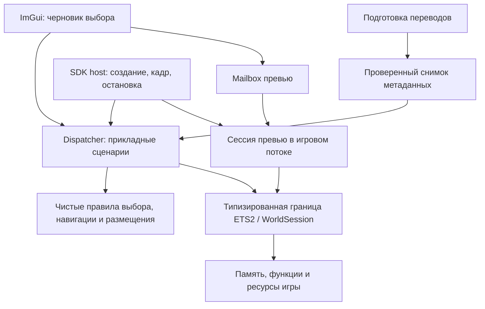

# Аудит архитектуры по ub-mode — 28.10.2026

## Вывод

Плагин выполняет основные функции, но архитектурные и тестовые требования
ub-mode пока не выполнены. Основные причины: смешение сценариев диспетчера
с игровым ABI, высокая сложность контроллеров и недостаточная проверка
подготовщика данных. Ни зелёный CTest, ни работа одного превью сами по себе
не подтверждают корректность всех внутренних вызовов игры.

Проверено текущее рабочее дерево, включая незакоммиченные изменения, а не
только опубликованный коммит `b3b657d6e064e653fe727b8a9f224dd48effeeb3`.
Снимок исходников определён [SHA-256-манифестом](ub-mode-2026-10-28/source-manifest.json).
Исходный скилл закреплён на `unclebob/ub-mode@57a8bdd28e45ed41900ace0bafa2ff76dd9ed70f`.
Пользователь разрешил сразу исправлять замечания после формирования отчёта.

## Что уже устроено правильно

- Игровые операции выполняются в callback SDK; GUI передаёт запросы и читает
  снимок. Подготовка переводов вынесена из игрового потока.
- Проверка полного хеша EXE ограничивает использование ABI известной сборкой.
- Превью использует игровой виджет и не конвертирует модели при каждом выборе.
  Отдельно удерживается COM-ссылка до завершения GUI-кадра.
- `JobNavigation`, форматирование единиц и нормализация выбора выделены в
  небольшие функции, проверяемые без запущенной игры.
- Словарь локализации публикуется как неизменяемый снимок. Каталог GUI повторно
  использует векторы, если поколение каталога не изменилось.
- Создание предложения предусматривает восстановление прежнего предложения
  при отказе принятия. Выбор и «Удиви меня» отделены от создания заказа.

## Измерения

| Проверка | Результат | Область и ограничение |
| --- | --- | --- |
| CTest | 12/12 пройдено | Имеющиеся тесты; не процент покрытия DLL |
| Crapper | 24 из 45 Python-функций имеют CRAP ≥ 10 | Все Python-инструменты, включая прежний конвертер |
| Crapper, действующий runtime | `prepare`: 272; подготовка ресурсов `main`: 210; `active_mods`: 20,67 | Покрытие четырьмя существующими Python-fixture-тестами |
| Dryer, порог 0,8 | Совпадений не найдено | Только поддерживаемые Python-источники |
| Mutator | 5 killed, 16 survived, 47 uncovered; 23,8% выполненных | Только `tools/offline-bootstrap.py`; не весь плагин |
| Lizard 1.24.3 | 195 C++-функций, 40 с CCN ≥ 10 | Собственные `.cpp`/`.hpp`; не CRAP и не измерение покрытия |
| Crapper по `src/` | `No source files to analyze`, exit 0 | C++ не поддерживается; это не успешный quality gate |
| Игровая проверка | Окно и несколько обновлений превью работают | ETS2 1.61.1.9, локальная копия профиля, ProMods 2.84, 18 модов |

Измеренные полные задержки нескольких игровых превью — примерно 0,31–0,44 с.
В ProMods обнаружены 391 груз, 3009 компаний и 156 прицепов; это размер каталога,
а не утверждение о ручной проверке каждого элемента.

У Crapper/Dryer/Mutator этих версий нет C++-анализатора. Полный CRAP и mutation
score C++ не измерены. Lizard не выдаётся за Crapper. 0% покрытия отдельных
Python-функций означает отсутствие выполнения в данном наборе автотестов,
а не отсутствие их использования игрой. Выжившая мутация требует разбора:
она может указывать на пропущенный сценарий или быть эквивалентной.

## Замечания

### A1 — P1: неверный контракт домашнего каталога

`src/offline_assets.cpp:30` возвращает аргумент `-homedir` без добавления
`Euro Truck Simulator 2`, хотя игра использует вложенный каталог. Затем
`tools/offline-bootstrap.py:5` трактует отсутствующий журнал как отсутствие
активных модов. Воспроизводимый probe получил **0 вместо 18**. Подготовщик
может опубликовать неправильные переводы и сведения об исключённых областях.

Принципы: Boundary Discipline, Get the data shape right, Fix Root Causes.
Исправление: один resolver домашнего каталога; различать отсутствие журнала,
неполный журнал и явно загруженный профиль без модов. Добавить регрессии на
нестандартные пути, Workshop и архивы вне стандартной папки.

### A2 — P1: граница ABI остаётся частью прикладной логики

`src/dispatch.cpp:293`, `src/dispatch.cpp:407`, `src/dispatch.cpp:829`,
`src/engine_route.cpp:20`, `src/native_preview.cpp:92` содержат прямую работу
с игровыми адресами, строками и refcount. `native_preview_abi.hpp` централизует
только часть контрактов. Чтение памяти и управление владением повторяются.
Исправленное падение строки иллюстрирует этот класс ошибок; само падение уже
исправлено и не объявляется новым открытым дефектом.

Принципы: One decision lives in one place, Boundary Discipline, Type System
Discipline. Исправление: общий адаптер доступа к памяти и типизированных
вызовов, явные owning/borrowed-типы и область жизни игрового мира; прикладной
код должен получать проверенные значения, а не вручную повторять ABI.

### A3 — P1: тестовый слой неполно проверяет действующий runtime

`tests/native_preview_test.cpp:4` включает `.cpp` реализации. Инициализация,
назначение объекта и draw подменены имитациями. Это полезно для очередей и COM,
но имитация уже пропускала неверный контракт строки. Python-тесты в основном
упражняют прежний подготовщик моделей; реальная подготовка переводов имеет
непокрытые ветви. Mutator по bootstrap не прошёл gate.

Принципы: Test Behavior, Not Implementation; honest tests; Cover the uncovered.
Исправление: тестировать границу через явный адаптер, компилировать реализацию
отдельно, расширить сценарии действующей подготовки и закрепить игровой smoke
test. Для игрового теста обязательны `PC_local`, проверенные моды и сохранение
из `/home/profiles/…`; один `-homedir` не изолирует Steam Cloud.

### A4 — P2: контроллер диспетчера объединяет слишком много сценариев

`src/dispatch.cpp` — 883 строки. `Frame` (`:564`) имеет CCN 122,
`Catalogue` (`:407`) — 72, `Generate` (`:293`) — 50. В одном месте смешаны
каталог, настройки, подбор случайного заказа, маршруты, цена, GPS и создание
предложения. Небольшое изменение трудно проверять независимо.

Принципы: Keep business logic pure, Sequence work into verifiable units.
Исправление: выделить этапы lifecycle/settings/catalogue/selection/route/job;
вынести правила выбора и план размещения в чистые функции. Основной Frame
должен координировать этапы. Простые switch-таблицы не дробить ради числа.

### A5 — P2: предметная модель допускает некорректные состояния

`src/dispatch.hpp:16` использует одинаковый `uint64_t` для груза, компаний
и прицепа; ноль одновременно означает отсутствие выбора и автоматический
прицеп. `Request` и `Snapshot` представляют комбинации флагов, которые затем
исправляются нормализацией и повторной валидацией. Полезные проверки есть,
но типы не выражают гарантии, на которые опирается внутренний код.

Принципы: Model the Domain, Make illegal values impossible.
Исправление: отделить черновик GUI от проверенного запроса, ввести различимые
идентификаторы, явный выбор Auto/Manual и способ размещения. Документировать
основные термины. Проверять вход на границе и сохранять проверку смены мира.

### A6 — P2: жизненный цикл превью трудно проверять по частям

`src/native_preview.cpp:211` — CCN 42; состояние распределено между множеством
переменных файла, ручными освобождениями и функциями Frame/Draw/Shutdown.
Существующие mutex, поколения мира/устройства и удержание SRV решают важные
задачи, но структура не закрепляет единственного владельца ресурсов.

Принципы: Separate before serializing shared state, ownership, refactoring.
Исправление: отделить mailbox GUI от игровой сессии превью; собрать владение
ресурсами в объекте с явным Reset, выделить apply/update/publish. Сначала
закрепить смену выбора, паузу, закрытие и сброс устройства тестами.

### A7 — P2/P3: обновление установки и старые инструменты

`tools/install-portable.ps1:35` и `:52` выбирают новые значения по умолчанию
вместо сохранения пользовательских DataDirectory/extra_mods при обновлении.
`:40` копирует все tools, включая прежние конвертеры, которые runtime больше
не вызывает. Старые функции повышают стоимость сопровождения и загрязняют
общие показатели качества.

Принципы: Idempotent operations, Subtract Before You Add.
Исправление: сохранение настроек при отсутствии явного override; отделение
исследовательских/устаревших инструментов от поставляемого runtime. Не удалять
непроверенную работу и пользовательские кэши только ради уменьшения отчёта.

## Целевая структура и порядок исправлений

1. A1: регрессия и исправление домашнего каталога и discovery модов.
2. A3/A7: тесты подготовки, настройки обновления, отделение старого pipeline.
3. A2/A5: общая граница памяти/владения и проверенная модель запроса.
4. A4: разделение контроллера и чистые правила.
5. A6: явная сессия превью и тесты через интерфейс вместо включения `.cpp`.
6. Повторить метрики, CTest и игровой smoke test на локальном профиле с модами.

Не требуется заменять C++ другим языком или вводить крупный framework.
Выделение границ должно сохранять поведение текущего работающего плагина.

## Доказательства и журнал

- [Исходные результаты и воспроизведение](ub-mode-2026-10-28/README.md).
- [Журнал действий и причин](UB-MODE-ACTIONS.md).
- [Установленный скилл](../../.agents/skills/ub-mode/SKILL.md).

Этот документ фиксирует исходное состояние до исправлений. Итоговые результаты
должны быть записаны отдельно, чтобы не подменять измеренную исходную точку.
